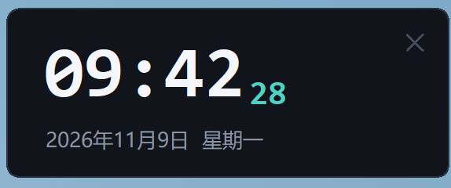

# 桌面时钟 Desktop Clock

一个轻量的 Windows 桌面悬浮时钟，使用 Python + Tkinter 编写，无第三方依赖。



## 功能

- 置顶悬浮、无边框圆角卡片
- 大号「时:分」+ 青色秒数 + 日期/星期
- 按住时钟任意位置拖动，自动记住上次位置
- 右上角 × 或右键菜单随时关闭
- 右键可切换「窗口置顶」、「回到右上角」
- 单实例运行，重复启动不会出现两个时钟
- 适配 Windows 高 DPI 缩放

## 运行

需要 Windows 10/11 和 Python 3.8+（官方 Python 自带 tkinter）。

```bat
pythonw desktop_clock.pyw
```

也可以直接双击 `desktop_clock.pyw`。用 `pythonw` 启动不会出现黑色控制台窗口。

## 使用

| 操作 | 方式 |
| --- | --- |
| 移动 | 按住时钟任意位置拖动 |
| 关闭 | 点右上角 ×，或右键 →「关闭时钟」 |
| 置顶切换 | 右键 →「窗口置顶」 |
| 复位位置 | 右键 →「回到右上角」 |

位置和置顶设置保存在程序目录的 `clock_config.json` 中（已加入 `.gitignore`）。

## 文件

- `desktop_clock.pyw` — 时钟程序
- `preview.png` — 界面预览
- `README.md` — 说明文档

## 说明

程序仅使用 Python 标准库（tkinter / ctypes），不会联网，也不收集任何数据。
